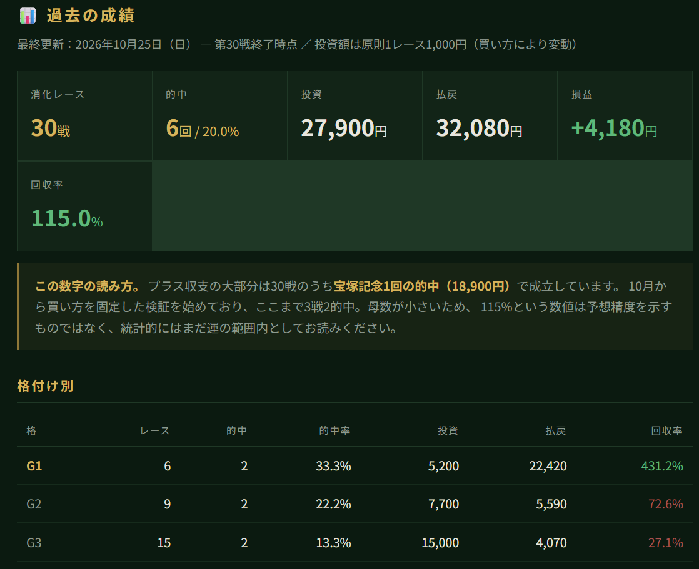
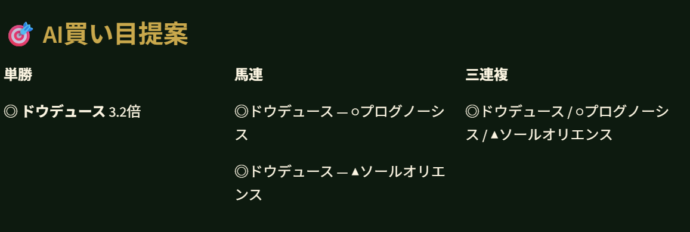
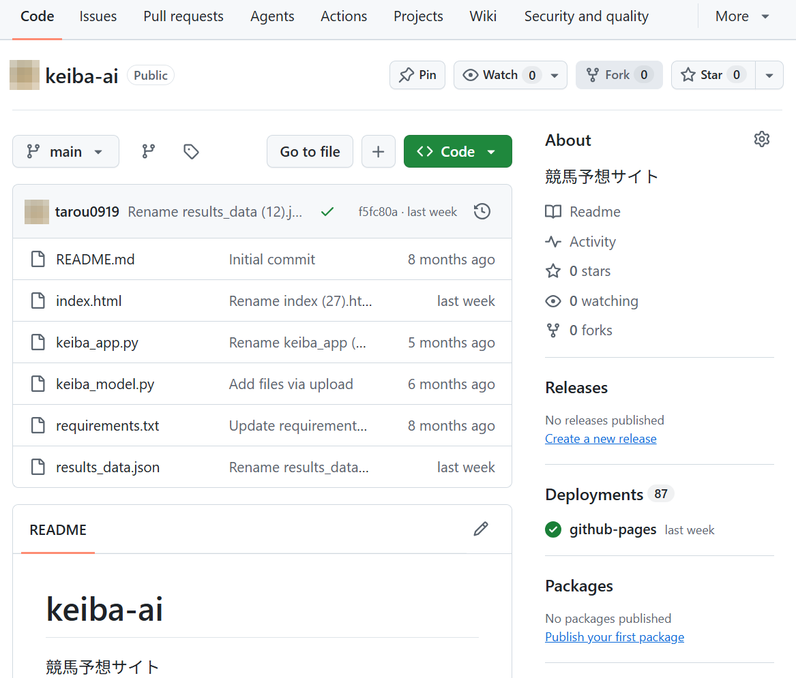
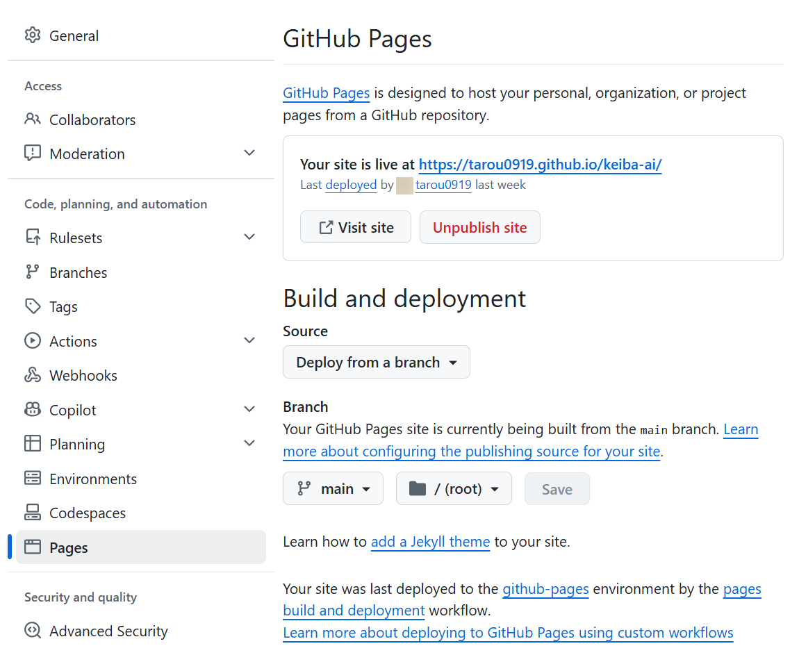
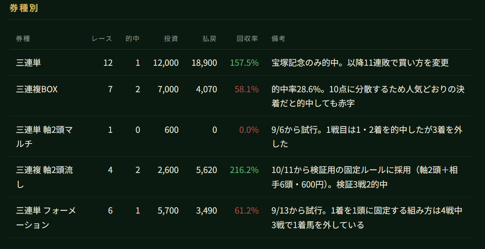

プログラミング未経験の会社員です。コードは一行も書いていません。**やりたいことを普通の日本語でAIに伝えるだけで**、Webサイトと予想アプリができました。

できただけでは終わらせずに、3か月間、毎週実際に動かし続けました。この記事は、その運用の記録です。

サイトはこれです。

https://tarou0919.github.io/keiba-ai/



この記事は成功談ではありません。**自分のサイトに、開発中のダミーの数字が何か月も載ったままだった話**とか、**AIが作ったデータとAIが作ったアプリが噛み合わずに止まった話**とか、そういうものが中心です。作るところより、作った後に運用して初めて出てくる詰まりのほうが、書く価値があると思ったからです。

こんなことを書いています。

- AIに実際どう頼んだか（送った文そのまま）
- 動かなくなったとき、どうやって原因を見つけたか
- 作った後、運用で何が起きたか

競馬の知識がなくても読めるように書いたつもりです。

---

## 3か月の結果

先に数字を出しておきます。3か月の実測値です。

| 項目 | 数字 |
| --- | --- |
| 消化レース | 30戦 |
| 的中 | 6戦（20.0%） |
| 投資 | 27,900円 |
| 払戻 | 32,080円 |
| 損益 | **+4,180円** |
| 回収率 | **115.0%** |

| 格 | 戦績 | 回収率 |
| --- | --- | --- |
| G1 | 6戦2的中 | 431.2% |
| G2 | 9戦2的中 | 72.6% |
| G3 | 15戦2的中 | 27.1% |

プラスではありますが、**G1の2回がなければ大きなマイナスです。** 30戦では偶然をふるい落とせません。「AIで勝てた」という話として読まないでください。

もうひとつ正直に書くと、**30戦のうち詳細な記録があるのは、8月2日以降の18戦だけ**です。それ以前の12戦は券種と収支しか残しておらず、日付も買い目も着順も記録していませんでした。記録を取る習慣ができたのが8月からで、この記事の「3か月」はそこからの期間を指します。サイト自体は2026年の3月頃から存在します。

---

## 作ったもの

3つあります。

**① 公開サイト（GitHub Pages）**
`index.html` 1枚だけの静的サイトです。次回のレース、重賞情報、全30戦の記録、使い方、免責事項が載っています。全レースの記録には、外れたレースの敗因も書いてあります。

**② 予想アプリ（Streamlit Cloud）**
出走表のCSVを読み込ませると、LightGBMのモデルが各馬に0〜100のAIスコアを付け、◎○▲の印と買い目候補を出します。**着順を予想するものではありません。**



※画面は表示の例で、実際に購入した買い目ではありません。

**③ 記録用のファイル群**
`results_data.json` に全レースの結果、`verification_log.csv` に検証中のレースの詳細（60項目）を残しています。

リポジトリの中身はこれだけです。

```
README.md
index.html
keiba_app.py
keiba_model.py
requirements.txt
results_data.json
```



ライブラリは `streamlit / lightgbm / scikit-learn / pandas / numpy / openpyxl / xlrd`。環境はWindows 11、AIはClaude（現在はMaxプラン）です。

かかっているお金は、ClaudeのMaxプラン（月約15,000円）だけです。GitHub PagesもStreamlit Cloudも無料の範囲で使っています。

---

## AIへの頼み方

一番聞かれるところだと思うので、**実際に送った文をそのまま出します。** 記録に残っている文言です。

| 場面 | 実際に送った文 |
| --- | --- |
| サイトを作り始めたとき | 競馬の予想サイトを作って下さい。 |
| アプリにしたいと思ったとき | 予想ソフトをPythonで作ることは可能ですか？ |
| 精度を上げたいとき | Pythonで予想精度を上げる事は出来ますか？ |
| ページがばらばらになったとき | 一つにまとめる事は出来ますか？ |
| 毎週のデータ変換 | 先ほどの両レース、CSVにして下さい。 |
| 毎週の結果反映 | 結果を反映させて下さい。 |
| オッズの確認 | 変化ないですか？（出馬表PDFを添付して） |

見てのとおり、**専門用語がひとつも入っていません。**

「静的サイトジェネレータで」とか「勾配ブースティングで」とか、そういう言い方は一度もしていません。知らないので書けませんでした。それでも、やりたいことを普通の言葉で伝えれば、AIのほうが「ではこういう方法でやりましょう」と提案してくれます。LightGBMを使うことになったのも、GitHub Pagesで公開することになったのも、私が選んだのではなく提案されたからです。

もうひとつ大事だったのが、**分からない操作は、そのたびに手順を聞いた**ことです。

GitHubでファイル名を変えるにはどうするのか、いらないファイルを消すにはどこを押すのか、アップロードしたファイルがトップページにならないのはなぜか。全部その場で聞いて、言われたとおりにクリックしました。「分からないまま進めて、あとでまとめて調べる」を一度もやらずに済んだのが、3か月続いた理由だと思っています。

---

## 毎週やっていたこと

日曜のレースに向けて、こういう順番で動いていました。

1. 開催カレンダーを見て、その週の重賞を1つ選ぶ
2. JRA公式サイトから出馬表のPDFをダウンロード
3. PDFをAIに渡して、アプリが読めるCSVに変換してもらう
4. レース当日、オッズが確定したPDFをもう一度ダウンロードして渡す
5. 馬場状態とクッション値を確認して伝える
6. アプリにCSVを食わせて、AIスコアと印を出す
7. 買い目を決めて、JRAの投票画面で購入
8. レース後、結果PDFを渡して収支を計算してもらう
9. `index.html` を作り直して、GitHubにアップロード

**データ取得はすべて手作業です。** スクレイピングのスクリプト（`keiba_scraper.py`）は最初に作ったのですが、30戦の運用で一度も使いませんでした。結局いつもJRAの公式PDFを自分でダウンロードしていました。作ったけど使わなかったもの、というのは正直に書いておきます。

PDFをアップしてから馬券を買い終えるまでは、だいたい6分から11分でした。ただ、それは最後の仕上げだけの時間です。リサーチから購入、結果をサイトに反映するまでを含めると、1レースにつき1日〜2日かかっています。

---

## つまずき① アプリが落ちた（列の名前が合わなかった）

最初の大きな詰まりです。CSVを読み込ませた瞬間、アプリがエラーで止まりました。

### 何が起きていたのか

先に、専門用語なしで説明します。

CSVというのは、要するに**表**です。1行が1頭の馬で、「馬名」「オッズ」「馬体重」といった**列の名前**が付いています。アプリはこの表を受け取って、決まった名前の列を探しにいきます。

このとき、アプリは `horse_weight`（馬体重）という名前の列を探していました。ところが、AIが作ってくれたCSVには、同じ馬体重が `prev_horse_weight` という名前で入っていたんです。

人間が見れば「どっちも馬体重でしょ」と分かります。でも**プログラムは名前が違えば別物として扱う**ので、探していた列が見つからず、そこで止まりました。

ここが未経験者にとって一番の落とし穴だと思います。**CSVもアプリも、どちらもAIが作ったのに、その2つが噛み合っていなかった。** AIは1回ごとの頼みには正しく答えますが、「前に作ったあのファイルと名前を揃えておいて」までは、こちらが言わないと気づいてくれません。

### 実際の画面

画面に出たのはこれだけです。

```
AttributeError: This app has encountered an error. The original error
message is redacted to prevent data leaks.
```

**エラーの本文が伏せられていて読めません。** Streamlit Cloudは情報漏れを防ぐために中身を隠すので、これだけでは何が起きたのか分からない。

手がかりはその下に出ていた**トレースバック**（エラーになるまでにプログラムが通った場所の一覧）だけでした。

```
File "/mount/src/keiba-ai/keiba_app.py", line 324, in <module>
    feat_df = build_features(raw_df, distance, course, track_cond)

File "/mount/src/keiba-ai/keiba_app.py", line 194, in build_features
    df['horse_weight_kg'] = pd.to_numeric(df.get('horse_weight', 490), errors='coerce'
```

**この画面をそのままAIに見せたら、原因を特定してくれました。** 私がやったのは、スクリーンショットを貼って「バグが出ます」と送っただけです。

問題はこの一行でした。

```python
df.get('horse_weight', 490)
```

「`horse_weight` という列を取ってきて。なければ代わりに `490` を使って」という意味です。親切なつもりの書き方ですが、ここに罠があります。

| 状況 | 返ってくるもの |
| --- | --- |
| 列がある | 列まるごとのデータ（Series と呼ばれる形） |
| 列がない | ただの数値ひとつ（`490`） |

**返ってくる「形」が変わってしまう**わけです。

このあとアプリは、空欄を埋める `.fillna()` という処理を呼びます。これは「列まるごと」に対してならできますが、「ただの数値ひとつ」にはできません。だから落ちた。

### どう直したか

直し方は2つありました。

- アプリ側を直す（列がなくても安全に動くようにする）
- CSV側の列名をアプリに合わせる

**CSV側を直しました。** そのほうが速かったのと、アプリを直すとデプロイをやり直す必要があったからです。列名を `horse_weight` にして、`weight_change` も足して、その場で解決しました。

ただ、これは対症療法です。アプリ側の恒久的な直し方はこうなります。

```python
def safe_col(df, name, default):
    """列が無ければ default で埋めた Series を返す"""
    if name in df.columns:
        return pd.to_numeric(df[name], errors='coerce').fillna(default)
    return pd.Series(default, index=df.index, dtype=float)

df['horse_weight_kg'] = safe_col(df, 'horse_weight', 490)
```

**この修正、3か月経った今もまだ当てていません。** 動いているから後回しにしてしまった、という典型です。

### 持ち帰ってほしいこと

- **AIが作ったデータとAIが作ったアプリでも、列の名前が食い違えばアプリは止まる**
- **止まったら、エラー画面をそのままAIに見せればいい。** 自分でエラー文を読み解く必要はありません

---

## つまずき② 自分のサイトに、嘘の数字が載っていた

これが一番こたえました。

8月2日、サイトの現状をAIに見てもらったとき、公開されているページの中身と、自分の投票記録を突き合わせてもらいました。そうしたら、表示されている数字が実際と全然違っていたんです。

| 項目 | サイトに出ていた数字 | 実際 |
| --- | --- | --- |
| 回収率 | 112% | 135.0% |
| G1予想的中 | 3 / 7 | 1 / 3 |
| 今月的中率（単勝） | 38% | 記録なし |
| 複勝的中率 | 61% | 記録なし |
| 分析レース数 | **1,240** | **14** |

**開発中に入れたサンプルの数字が、そのまま公開されていました。**

一番ひどいのが「分析レース数 1,240」です。実際には14レースしか扱っていないのに、1,240と書いてある。サイトを作るときに見栄えの確認用に入れた数字を、消し忘れたまま何か月も放置していたわけです。

同じ日に、実測値版の `index.html` を作り直して差し替えました。ついでに、

- 4月のレース情報（大阪杯など）が残っていたのを更新
- 「過去の成績」セクションが見出しだけで中身が空だったので、全レースの記録を載せる
- 依存症の相談窓口の案内を見直す（この記事を書くにあたって、公的な窓口の案内にあらためて差し替えました）

もやりました。

**教訓としては、「作ったときのダミーは、作った日に消す」に尽きます。** 後からだと、自分では気づけません。私は公開してから何か月も気づきませんでした。

---

## つまずき③ JRAの投票画面で、2回弾かれた

馬券を買う画面でも詰まりました。両方とも金額の入力です。

ここから競馬の用語が出てくるので、4つだけ説明させてください。

- **三連単** … 1〜3着の3頭を、着順どおりに当てる
- **三連複** … 1〜3着の3頭を、順番を問わずに当てる
- **軸** … 必ず3着以内に来ると決めて、買い目の中心に置く馬
- **1着固定** … 1着になる馬を1頭に決め打ちする買い方

**1回目（紫苑ステークス）**

三連複の軸2頭ながしで4組。合計金額に「1000」と入れたら、こう出ました。

```
※合計金額の入力に誤りがあります。再度入力してください。
```

理由は単純で、**JRAは1組100円単位**なので、1,000円を4組で割ると1組250円になってしまう。受け付けてもらえません。結局、各200円×4組＝800円で買って、余った200円は単勝に回しました。

**2回目（セントウルステークス）**

今度は逆です。三連単の軸2頭ながしマルチで相手を3頭選んだら18組になり、合計1,800円。予算は600円だったので「600」と入れて、また弾かれました。相手を1頭に絞って6組＝600円にして購入。

買い方の入力は3段階あります。

1. 式別を選ぶ（3連複 / 3連単 など）
2. 方式を選ぶ（通常 / ボックス / フォーメーション / ○着ながし）
3. 馬番ごとに軸・相手をチェックする

**組数は、馬を選んだ時点で決まってしまいます。** だから「1,000円で買いたい」から入ると、だいたい合いません。先に組数を確定させて、そこから金額を逆算するのが正解でした。

ついでに書くと、**AIも組数の計算を2回間違えました。** 三連単フォーメーションで「12組です」「10組です」と言われて、実際の画面を見たら両方とも8組。三連単フォーメーションは同じ馬が重複する組み合わせが除外されるので、単純な掛け算と一致しないんです。実画面を見て気づけたのは、たまたまでした。

---

## GitHubでの公開と、毎回のファイル名直し

まず、最初にサイトを公開するときの設定です。これは1回だけで済みます。

1. リポジトリを作り、トップページにしたいファイルを `index.html` という名前で上げておく
2. リポジトリ上部のタブから「Settings」（歯車のアイコン）を開く
3. 左メニューの「Pages」を押す
4. 「Build and deployment」の「Source」で「Deploy from a branch」を選ぶ
5. 「Branch」で「main」と「/ (root)」を選び、「Save」を押す
6. 数十秒〜数分待つと、「Your site is live at …」と公開URLが表示される



詰まったのは、そのあとの更新です。更新のたびにやっていた操作はこうでした。

1. リポジトリで「Add file」→「Upload files」
2. ファイルをドラッグ＆ドロップ
3. 「Commit changes」

ところが、ダウンロードしたファイルは `index (13).html` `index (14).html` のように連番が付いています。そのままアップロードすると、トップページにならない。毎回 `index.html` にリネームしてからアップロードする必要がありました。

一度やらかしたのが、`index (3).html` と `index.html` を両方リポジトリに上げてしまったことです。古いほうを「…」→「Delete file」で消して解決しましたが、これも最初は何が起きているか分かりませんでした。

`results_data (4).json` を `results_data.json` に直す、`results_datajson`（ピリオドが抜けている）を消す、といった作業も繰り返しています。

慣れてからは、既存ファイルの更新は鉛筆アイコンから中身を全選択して貼り替えるほうが早い、と分かりました。コミットの横がオレンジの丸ならビルド中、緑のチェックで公開完了。1〜2分です。古い表示が残るときはスーパーリロード（Ctrl+F5）。

---

## 一番時間がかかったのは、買い方の試行錯誤

技術的な詰まりより、こっちのほうが長引きました。

先に結論を書きます。**予想そのものは当たっていたのに、買い方のせいで収支にならない期間が続きました。そして、原因がそこにあると気づくまでに2か月かかりました。**

用語は「つまずき③」の冒頭で説明したものと同じです。買い方はこう変わっていきました。

| 時期 | 券種 | 成績 |
| --- | --- | --- |
| 〜7月 | 三連単 | 12戦1的中 |
| 8月 | 三連複BOX 5頭 | 7戦2的中（回収率58%） |
| 9月上旬 | 三連複 軸2頭流し（紫苑S）／三連単 軸2頭マルチ（セントウルS） | 各1戦0的中 |
| 9月中旬〜10月上旬 | 三連単 フォーメーション | 6戦1的中 |
| 10月中旬〜 | 三連複 軸2頭流し（買い方を固定して検証） | 検証中 |



記録を見返して、まずかった点が2つ見つかりました。

**1つ目。1着固定をやめるべきだった。** 1頭に全部を賭ける形になっていました。4レース試して的中は1回、固定した馬の着順は13着、16着、9着です。

**2つ目。人気薄を3着欄にしか置いていなかった。** 京都大賞典で、3着欄に入れた11番人気が1着に来ました。同じことが他に2レースでも起きています。「人気薄は3着まで」という無意識の決めつけが、繰り返し裏目に出ていました。

どちらも**着順を当てにいったせいの失敗**です。そこで、9月の紫苑ステークスで一度試していた、順番を問わない三連複に戻しました。これなら着順の決めつけ自体が消えます。

もう1つ、記録を取っていたから分かったことがあります。15レース分を数えたら、**選んだ5頭のうち3着以内に入ったのは「2頭」が一番多く、47%**でした。3頭以上入ったのは20%しかない。つまり「あと1頭足りない」が常態だったわけです。これを見て、相手を4頭から6頭に広げました。

今は買い方を固定して、20戦分のデータを取っているところです。ここまでの検証記録は3戦で、1,800円の投資に対して払戻5,620円。ただし3戦では何も言えません。

---

## AIに任せたこと、任せなかったこと

**任せたこと**

- Python・HTMLのコードを書く（私は一行も書いていません）
- PDFからデータを抜き出してCSVにする
- 収支の計算と、サイトの作り直し
- 買い方の相談、敗因の分析

**任せなかったこと**

- どのレースに出るか
- 最終的にどの買い方にするか
- いくら賭けるか

決めるところは自分でやりました。AIは「こうしてはどうか」と案を出してくれますが、**外れたときに困るのは自分です。** そこは渡さないほうがいいと思っています。

あと、**AIも間違えます。** 組数の計算を2回、開催スケジュールを何度か間違えました。オールカマーのときは馬場を「良」として作ったCSVを渡してしまい、実際は重馬場で、1番人気と2番人気が4着と11着。これは私が確認を怠ったせいです。

AIの出力を疑わずに通すと、こういうことが起きます。

---

## 3か月やって分かったこと

**作るのは早い。運用が長い。**
サイトもアプリも、AIに頼めば形になるのはあっという間でした。でも「毎週データを集めて、結果を記録して、サイトを直す」を3か月続けるほうが、はるかに大変でした。

**記録を取らないと、何も分からない。**
最初の12戦は記録を取っていなかったので、今になって何も振り返れません。8月から記録を始めて初めて、「あと1頭足りない」が47%という数字が見えました。**取っていない記録は、存在しないのと同じ**です。

**公開しているものは、定期的に自分で見に行く。**
ダミー値の件がそれです。作ったときは正しくても、放っておくと嘘になります。

**動いているコードの「あとで直す」は、だいたい直さない。**
`safe_col()` の修正は、3か月経ってもまだ当てていません。

---

## これから

- 買い方を固定したまま、20戦分のデータを揃える
- アプリに馬場状態・レース条件（ハンデ／別定／定量）・距離適性を入れる（今は手作業で補正しています）
- `safe_col()` の修正を、今度こそ当てる
- 学習データを増やす

正直、30戦では何も証明できていません。それでも、**自分で数えた数字が手元にある**というのは、やってよかったと思っている部分です。

---

## 最後に

このサイトは**無料・非営利**で運営しています。予想情報の有料販売は行っていません。JRAやnetkeibaなど外部サービスの画像・データの無断転載もしていません。

馬券は20歳以上でないと購入できません。また、のめり込みに不安やお悩みがあれば、ひとりで抱えずに相談してください。JRAも案内している「[公営競技ギャンブル依存症カウンセリングセンター](https://www.koeikyogi.jp/addiction/gcc.html)」（**0120-321-153**・予約受付 平日9:00〜17:00）で相談できます。お住まいの地域の精神保健福祉センターなどでも相談でき、近くの窓口は依存症対策全国センターの「[お近くの専門相談窓口・専門医療機関を探す](https://www.ncasa-japan.jp/you-do/treatment/treatment-map/)」で探せます。

余裕のある範囲で、記録を取りながら楽しむのが一番だと思います。
